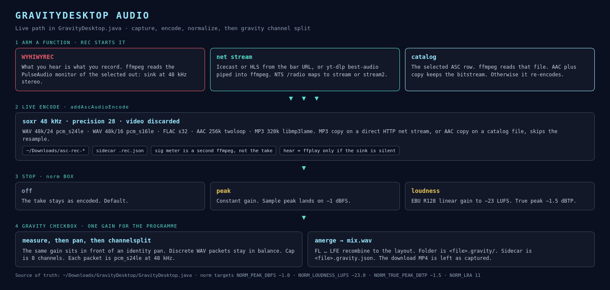

# GravityDesktop audio architecture

The live audio path is in `GravityDesktop.java` in this run directory. Four pictures sit beside these notes. The HTML that drew them is in `html/`.

| Picture | Page |
|---|---|
| [overview.png](overview.png) | This page. Arm, encode, norm, gravity. |
| [recorder.png](recorder.png) | [Recorder](recorder.md). WYHIWYREC, net stream, catalog. |
| [normalization.png](normalization.png) | [Normalization](normalization.md). Peak and EBU R128 loudness. |
| [gravity-channels.png](gravity-channels.png) | [Gravity channels](gravity-channels.md). Split, mix, layouts. |

## Order of operations

1. A function is armed. **REC**, or a second click on the armed function, starts the take.
2. ffmpeg writes `~/Downloads/asc-rec-*` through `addAscAudioEncode`.
3. **STOP** closes the processes. If **norm** is `peak` or `loudness`, the closed file is measured and rewritten.
4. If **gravity** is checked, `postProcessGravityChannels` writes `<file>.gravity/` and `<file>.gravity.json`. The same norm setting supplies one programme gain in front of the split.

**norm** defaults to `off`. **gravity** defaults to on. With norm off, the split is a labeled copy of the programme.

## What shares a clock

Recorded audio that is re-encoded is 48 kHz via libsoxr at precision 28. Gravity packets and `mix.wav` are pcm_s24le at 48 kHz. The signal meter also reads 48 kHz s16le, and it is a second ffmpeg on the monitor. It never feeds the take.

## Related notes

- [Recorder](recorder.md)
- [Normalization](normalization.md)
- [Gravity channels](gravity-channels.md)
- Tesseract address of the probed file: [docs/gravity/README.md](../gravity/README.md)
- Conceptual stack around probe and mint: [AnalogOnAnalog.md](../../AnalogOnAnalog.md)
- Process and port map: [LINUX_SYSTEM_MAP.md](../../LINUX_SYSTEM_MAP.md)
