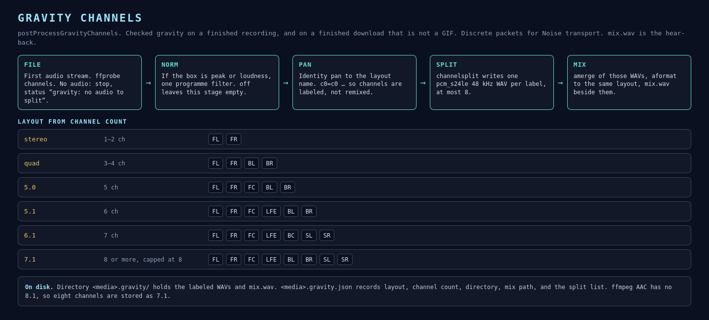

# Gravity channels

**gravity** on the utility row splits a finished file into discrete WAV packets and a mix. The checkbox defaults to on. It runs from two places:

- `finishNetRecord`, after an optional norm rewrite of an `asc-rec-*` take
- the end of a direct download, for a non-GIF file



## Graph

`probeAudioChannels` reads stream `a:0`. Zero channels stops with `gravity: no audio to split`. The count is capped at 8. `gravityLayoutName` and `gravityChannelLabels` pick the layout.

The filter graph is one chain:

1. Optional norm filter from the **norm** box. See [Normalization](normalization.md).
2. Identity `pan=<layout>|c0=c0|c1=c1|…` so each channel keeps its source slot.
3. `channelsplit=channel_layout=<layout>` into labeled pads `[FL][FR]…`.

Each pad is encoded `pcm_s24le` at 48 kHz into `<media>.gravity/<LABEL>.wav`.

The mix command takes those WAVs as inputs:

```
[0:a][1:a]…amerge=inputs=N,aformat=channel_layouts=<layout>[a]
```

Output: `<media>.gravity/mix.wav`, also pcm_s24le at 48 kHz.

## Layouts

| Channels | Layout | Labels |
|---|---|---|
| 1–2 | stereo | FL FR |
| 3–4 | quad | FL FR BL BR |
| 5 | 5.0 | FL FR FC BL BR |
| 6 | 5.1 | FL FR FC LFE BL BR |
| 7 | 6.1 | FL FR FC LFE BC SL SR |
| 8 | 7.1 | FL FR FC LFE BL BR SL SR |

ffmpeg’s AAC encoder has no 8.1 layout. Eight channels are stored as 7.1. Counts above 8 are capped before this table, so a wider source contributes its first eight channels.

## Sidecar

`<media>.gravity.json`:

```json
{
  "ok": true,
  "label": "NLS Codec",
  "alias": "nonlineari",
  "layout": "stereo",
  "channels": 2,
  "dir": "$HOME/Downloads/example.gravity",
  "mix": "$HOME/Downloads/example.gravity/mix.wav",
  "split": [
    "$HOME/Downloads/example.gravity/FL.wav",
    "$HOME/Downloads/example.gravity/FR.wav"
  ]
}
```

A runtime log event `gravity_channels` records the source path, layout, and channel count.

## Why the gain is programme-wide

Peak-normalizing each WAV on its own would raise a quiet LFE or rear to the same peak as the front, and the mix would change. The measure is `volumedetect` or `loudnorm` on the source programme. That one filter is applied before the split. The amerge rebuilds the same programme, shifted by that gain. A stereo smoke test of this graph landed the mix at −1.0 dBFS.
