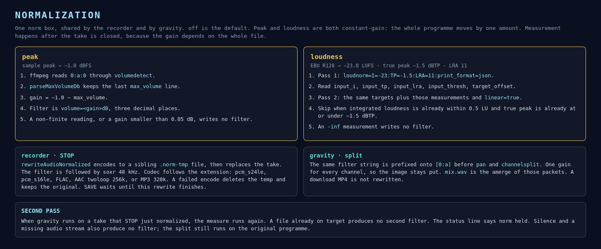

# Audio normalization

Wikipedia’s two operations are both in the **norm** box on the utility row, next to **gravity**:

- **Peak normalization** scales the programme so the highest sample hits a chosen level.
- **Loudness normalization** scales the programme so integrated loudness (ITU-R BS.1770 / EBU R128) hits a chosen level.

Both are one gain for the whole file. The recorder and gravity read the same box.



## Targets

| Mode | Target | Measure | Apply |
|---|---|---|---|
| off | — | — | No filter. |
| peak | −1.0 dBFS sample peak | `volumedetect` → `max_volume` | `volume=<gain>dB` |
| loudness | −23.0 LUFS, true peak −1.5 dBTP, LRA 11 | `loudnorm` pass 1, `print_format=json` | pass 2 with `linear=true` |

Constants in `GravityDesktop.java`: `NORM_PEAK_DBFS`, `NORM_LOUDNESS_LUFS`, `NORM_TRUE_PEAK_DBTP`, `NORM_LRA`.

Peak gain is `-1.0 - max_volume`. The filter is skipped when the reading is non-finite, or when the absolute gain is under 0.05 dB. The parser keeps the last `max_volume` line, because ffmpeg also prints an empty stats block at startup.

Loudness pass 2 is:

```
loudnorm=I=-23.0:TP=-1.5:LRA=11.0:measured_I=…:measured_TP=…:measured_LRA=…:measured_thresh=…:offset=…:linear=true
```

`linear=true` is the gain form of EBU R128. The pass is skipped when integrated loudness is already within 0.5 LU of −23 and true peak is already at or under −1.5 dBTP, and when a measured field is `-inf`.

## Recorder

On STOP, `rewriteAudioNormalized` measures the closed take and encodes a sibling `<stem>.norm-tmp.<ext>`. The audio filter is the norm filter followed by soxr at 48 kHz. The codec follows the extension and the format box, matching the live encode: pcm_s24le, pcm_s16le when the format name contains `16`, FLAC, AAC 256k twoloop, or MP3 320k.

The temp file replaces the take with an atomic move. If that fails, a normal replace is used. A non-zero ffmpeg exit, or a temp shorter than 32 bytes, deletes the temp and leaves the original. Status then reads `norm peak → <file>` or `norm loudness → <file>`.

A live pass that used `-c:a copy` is still re-encoded here. The gain can only be known after the file is complete.

**SAVE** does not copy the pre-norm file. It opens after the worker finishes.

## Gravity

`postProcessGravityChannels(path, mode)` runs the same measurement. A filter is inserted once:

```
[0:a]<norm filter>,pan=<layout>|c0=c0|…,channelsplit=channel_layout=<layout>[FL]…
```

Every discrete WAV and the later `mix.wav` share that gain, so a quiet channel is not lifted on its own. The source media file stays where it is. A download MP4 is unchanged. The normalized audio is the gravity folder.

When STOP has already normalized a take and gravity runs on that file, the second measure finds the target and adds no filter. Status says `norm held`. A measure error sets `norm failed` and the split continues on the unfiltered programme.

## Checks

`GravityDesktopConvertTest` checks the filter strings, then runs ffmpeg on a −20 dB sine. The peak result is −1.0 dBFS. The loudness result is −23.05 LUFS.
