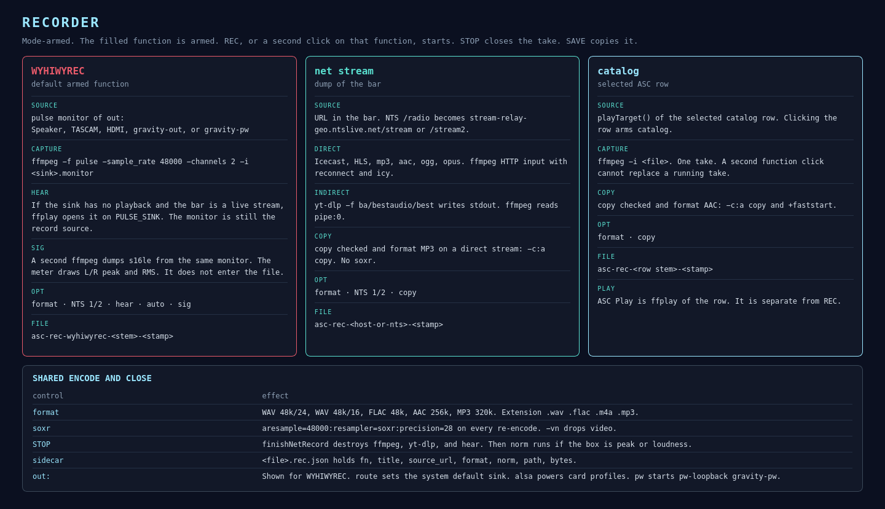

# Recorder

The rec strip is mode-armed. `recFn` is `WYHIWYREC`, `net stream`, or `ASC catalog`. A filled button is armed. It does not start capture by itself. **REC** starts the armed function. A second click on the armed function also starts. **STOP** and **SAVE** are global.



## WYHIWYREC

What you hear is what you record. ffmpeg opens the PulseAudio monitor of the sink chosen in **out:**.

```
ffmpeg -f pulse -sample_rate 48000 -channels 2 -i <sink>.monitor
```

**out:** lists hardware sinks, HDMI, `gravity-out`, and the PipeWire virtual sink `gravity-pw` (`pw-loopback -n gravity-pw`). **route** sets that sink as the system default. **alsa** turns card profiles on or off. **pw** starts or stops the virtual sink.

**hear**, when checked, looks for sink-inputs. If the sink is silent and the bar holds a live stream, ffplay plays that URL with `PULSE_SINK` set to the selected output. The recording still comes from the monitor, so the file is whatever that sink is playing.

**sig** starts a second ffmpeg on the same monitor and reads stereo s16le at 48 kHz. `RecMeter` draws left and right peak and RMS. That process is destroyed on STOP. Its samples are not written into the take.

**auto** starts WYHIWYREC on launch when the bar already holds a radio URL. A URL that arrived from the clipboard does not auto-start.

The options row for this mode shows format, NTS 1/2, hear, auto, and sig. The signal meter and the **out:** row are visible only in this mode.

Files: `~/Downloads/asc-rec-wyhiwyrec-<stem>-<yyyyMMdd-HHmmss>.<ext>`.

## net stream

The bar URL is the source. An NTS page or `/radio` URL is rewritten to `https://stream-relay-geo.ntslive.net/stream` or `stream2`, following **NTS 1** / **NTS 2**.

A direct stream (Icecast, HLS, `.mp3`, `.aac`, `.ogg`, `.opus`, `.m4a`) is an HTTP ffmpeg input with reconnect and ICY. Anything else is yt-dlp `-f ba/bestaudio/best` writing stdout, and ffmpeg reading `pipe:0`.

**copy** plus an MP3 format on a direct HTTP stream uses `-c:a copy` and skips soxr. Any other format re-encodes.

Options shown: format, NTS 1/2, copy.

Files: `~/Downloads/asc-rec-<stem>-<stamp>.<ext>`. Stems for NTS are `nts1` and `nts2`.

## catalog

The selected ASC row is the source. `recSelectedAsc` arms catalog and calls `startMonitorOrFileRecord` with `playTarget()`. Catalog does not call back into `startNetRecord`.

**copy** plus AAC uses `-c:a copy` and `+faststart`. Other formats re-encode.

Options shown: format, copy.

ASC **Play** is ffplay of the row. It is a separate action from REC.

## Encode

`addAscAudioEncode` always drops video (`-vn`). A re-encode runs:

```
aresample=48000:resampler=soxr:precision=28
```

| Format | Codec | Container |
|---|---|---|
| WAV 48k/24 | pcm_s24le | `.wav` |
| WAV 48k/16 | pcm_s16le | `.wav` |
| FLAC 48k | flac, compression 8, s32 | `.flac` |
| AAC 256k | native aac, twoloop, aac_low | `.m4a` |
| MP3 320k | libmp3lame, compression_level 0 | `.mp3` |

Live inputs use `-thread_queue_size 2048` and `-fflags +genpts`. Progress logs are discarded so a full stderr pipe cannot stall ffmpeg.

## Close

`finishNetRecord` sets `recRunning` false, then stops yt-dlp, the record ffmpeg, ffplay, and the signal meter. A file longer than 44 bytes is a take. The sidecar `<file>.rec.json` stores `fn`, `title`, `source_url`, `format`, `norm`, `path`, and `bytes`.

If **norm** is off, a checked **gravity** box splits the take immediately. If **norm** is peak or loudness, the rewrite runs first on a worker thread, then gravity. See [Normalization](normalization.md) and [Gravity channels](gravity-channels.md).

**SAVE** while a take is still recording, or while norm is writing, waits for that work and then opens the file chooser.
