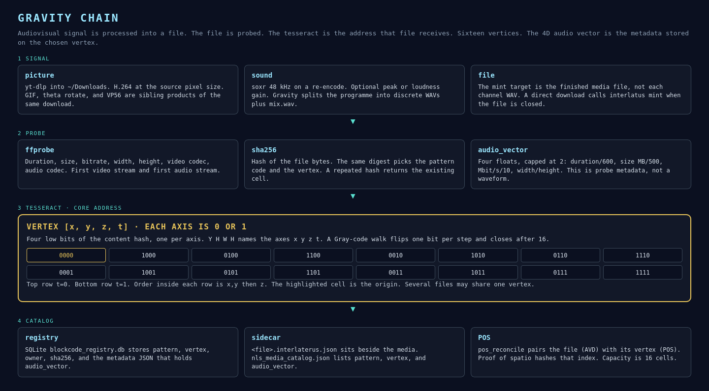

# Gravity

The core property of the chain is the tesseract. Picture and sound are processed into one file. The file is probed. That probe becomes a 4-number `audio_vector`. The file’s sha256 picks one vertex of the 16-vertex tesseract, and the vector is stored on that vertex.

| Picture | Page |
|---|---|
| [chain.png](chain.png) | This page. The whole chain, with the tesseract as the address. |
| [signal.png](signal.png) | [Audiovisual signal](signal.md). Picture, sound, and the four probe numbers. |
| [tesseract.png](tesseract.png) | [Tesseract](tesseract.md). Sixteen vertices, pattern, vector, Gray walk. |
| [position.png](position.png) | [Position](position.md). AVD paired with POS, and proof of spatio. |

Recorder levels, peak, and loudness are drawn in [docs/audio/](../audio/README.md). Those gains happen before a file is probed. They change the bytes. The tesseract address is a hash of the bytes that remain.

## What the chain does

1. **Signal.** A download or a take is written under `~/Downloads`. Picture is H.264 (or a GIF). Sound is 48 kHz when it is re-encoded. Gravity channel split writes sibling WAVs. The mint target is the media file.
2. **Probe.** `ffprobe` reads duration, size, bitrate, frame size, and the two codecs. SHA-256 reads the bytes.
3. **Tesseract.** Four low bits of the hash are `[x, y, z, t]`. The same hash builds a pattern code. `audio_vector_from_probe` builds the 4-float metadata vector. `mint_nft` stores both on the cell.
4. **Catalog.** SQLite, a sidecar, and `nls_media_catalog.json` keep the mint. `pos_reconcile` pairs the file (AVD) with the vertex (POS). Proof of spatio hashes that index. Capacity is 16 cells. A cell may hold more than one file.

The live desktop shows this while it runs: the mint line reads `probing → blockcode tesseract`, then the pattern and the vertex.

Sigma-9 opens the Gravity protocol. The prologue is the 9 bytes `GRAVITY`, `0x00`, `0x01`, from derivatives 1, 2, 3, 3. That handshake is how a client joins the live job and catalog stream. It is not a tesseract coordinate.
