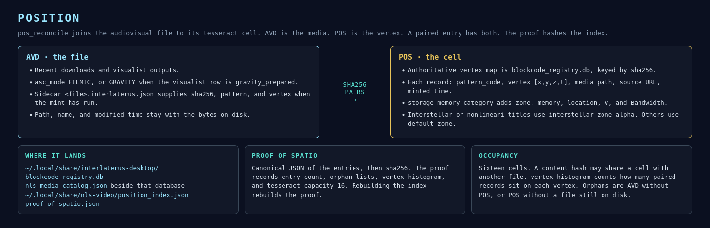

# Position

After the mint, the file and the vertex are a pair. AVD is the audiovisual file. POS is its place on the tesseract. `pos_reconcile` in `nls_video_pipe.py` builds that pair. Proof of spatio hashes it.

## AVD

Analog video data is the file side. `pos_reconcile` reads recent downloads, visualist catalog rows, and `<file>.interlaterus.json` sidecars. `asc_mode` is `FILMIC`, or `GRAVITY` when the visualist row is marked `gravity_prepared` or carries a raw H.264 stream.

A download that has not been minted yet can appear as AVD with no vertex. That entry is an AVD orphan until mint writes the cell.

## POS

The authoritative vertex map is `~/.local/share/interlaterus-desktop/blockcode_registry.db`, keyed by sha256. Each row supplies `pattern_code`, `[vertex_x, vertex_y, vertex_z, vertex_t]`, media path, source URL, and mint time.

`storage_memory_category` is attached from the visualist catalog when the filename matches. Otherwise a title containing interstellar or nonlineari receives `interstellar-zone-alpha`, `16GB`, `nls-visualist-dc-1`, `vp56-vol-1999`, and `10Gbps`. Other titles receive `default-zone`, `8GB`, `local-dc`, `h264-vol`, and `1Gbps`.

## Index and proof

| Record | Path |
|---|---|
| Registry | `~/.local/share/interlaterus-desktop/blockcode_registry.db` |
| Mint catalog | `~/.local/share/interlaterus-desktop/nls_media_catalog.json` |
| Sidecar | `<media path>.interlaterus.json` |
| Position index | `~/.local/share/nls-video/position_index.json` |
| Proof | `~/.local/share/nls-video/proof-of-spatio.json` |

`build_proof_of_spatio` serializes the entries in canonical JSON and stores the sha256 as `proof_digest`. The proof includes the summary, the orphan lists, the entry count, and `tesseract_capacity: 16`.

The summary counts paired entries, AVD-only orphans, POS-only orphans, how many of the 16 vertices are occupied, and a histogram of vertex keys `"x,y,z,t"`. A POS-only orphan is a cell whose media file is no longer on disk. An AVD-only orphan is a file with no vertex yet.

The desktop mint line is the same event from the other side. After a direct download, `triggerInterlaterusMint` runs `interlaterus_desktop.py mint`. The status text moves from `probing → blockcode tesseract` to the pattern and the vertex.
