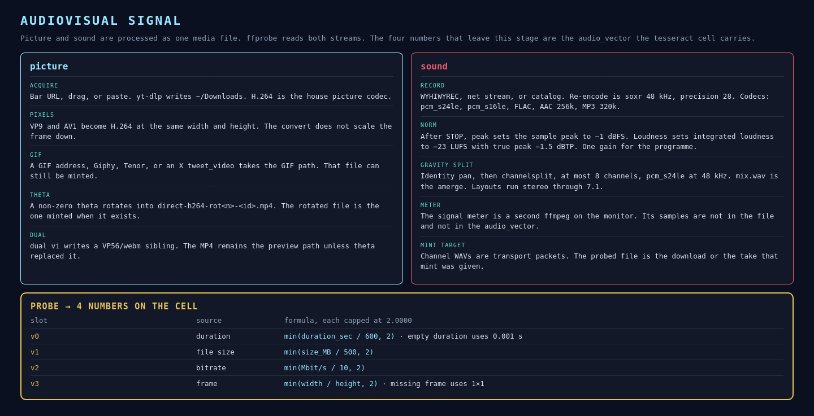

# Audiovisual signal

Picture and sound meet in one file. The tesseract never sees the waveform or the pixels directly. It sees the probe of that file, and a hash of its bytes.

## Picture

`GravityDesktop` downloads through yt-dlp into `~/Downloads`. The house picture codec is H.264. A VP9 or AV1 file is transcoded to H.264 at the same width and height. The convert does not scale the frame.

A GIF address, Giphy, Tenor, or an X `tweet_video` takes the GIF path. A non-zero theta writes `direct-h264-rot<n>-<id>.mp4` and that rotated file becomes the preview, and the mint target. **dual vi** writes a VP56/webm sibling and leaves the MP4 in place unless theta replaced the preview path.

## Sound

The recorder is documented in [docs/audio/recorder.md](../audio/recorder.md). A re-encode resamples with libsoxr at 48 kHz, precision 28. Formats are WAV 24-bit, WAV 16-bit, FLAC, AAC 256k, and MP3 320k.

**norm** runs after the take is closed. Peak is a constant gain to −1 dBFS sample peak. Loudness is an EBU R128 linear gain to −23 LUFS with true peak −1.5 dBTP. One gain moves the whole programme. See [docs/audio/normalization.md](../audio/normalization.md).

**gravity** then splits that programme. An identity pan names the channels, `channelsplit` writes at most eight `pcm_s24le` WAVs at 48 kHz, and `amerge` writes `mix.wav`. Layouts are stereo, quad, 5.0, 5.1, 6.1, and 7.1. See [docs/audio/gravity-channels.md](../audio/gravity-channels.md).

Those WAVs are the transport packets. They are not each minted. The probed file is the download, or the take passed to `interlaterus_desktop.py mint`.

The signal meter is a second ffmpeg reading the Pulse monitor as s16le. It draws peak and RMS. It does not enter the file, so it does not enter `audio_vector`.

## The four numbers

`audio_vector_from_probe` in `interlaterus_desktop.py`:

| Slot | Probe field | Value |
|---|---|---|
| v0 | duration | `min(duration_sec / 600, 2)`, with an empty duration treated as 0.001 s |
| v1 | size | `min(size_MB / 500, 2)` |
| v2 | bitrate | `min(Mbit/s / 10, 2)` |
| v3 | frame | `min(width / height, 2)`, with a missing frame treated as 1×1 |

Each component is rounded to four decimals. The vector is named for the blockcode tradition. It is a 4D embedding of probe statistics, the same rank as the tesseract, and it is stored as `metadata_vector` on the vertex the hash selected.
