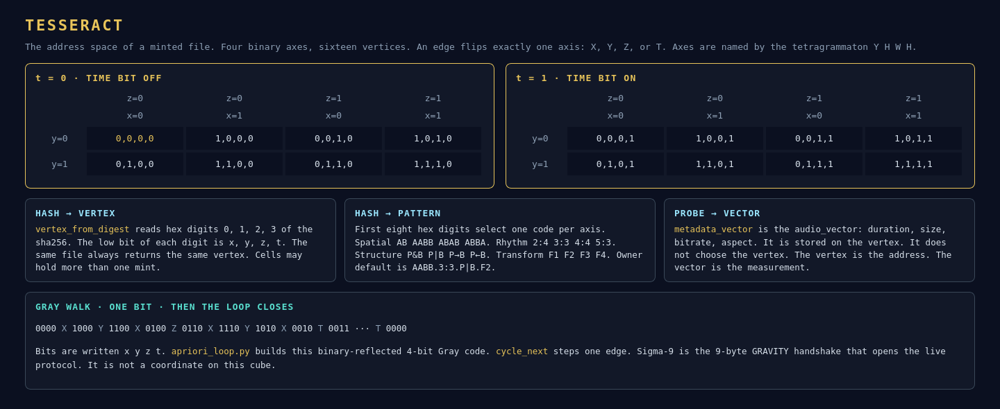

# Tesseract

A minted file occupies one vertex of a 4-dimensional hypercube. Each axis is 0 or 1, so there are 16 vertices. An edge changes exactly one axis. The axes are `x`, `y`, `z`, `t`, named by the tetragrammaton Y, H, W, H in `apriori_loop.py`.



## Address

`vertex_from_digest` takes the sha256 hex and reads digits 0, 1, 2, and 3. The low bit of each digit is `x`, `y`, `z`, and `t`. The same bytes always produce the same vertex.

`pattern_from_digest` reads the first eight hex digits as an integer and picks one symbol on each pattern axis:

| Axis | Alphabet |
|---|---|
| Spatial | `AB` `AABB` `ABAB` `ABBA` |
| Rhythm | `2:4` `3:3` `4:4` `5:3` |
| Structure | `P&B` `P\|B` `P→B` `P←B` |
| Transform | `F1` `F2` `F3` `F4` |

A pattern looks like `ABAB.2:4.P←B.F3`. The owner pattern on an Interlaterus mint is `AABB.3:3.P|B.F2` unless another owner is passed. If that pattern string is already in the registry, the mint appends six hex characters from the hash.

`pick_vertex` uses the digest whenever the hash exists. Without a digest it would take an empty cell, then the least-loaded cell. A content hash does not search for an empty cell. Sharing a vertex is allowed.

`mint_media_file` returns `already_minted` when the sha256 is already in `blockcode_registry.db`. The vertex does not move.

## Measurement on the cell

`audio_vector` is computed in the same mint and passed as metadata. `BlockcodeNFTClient.mint_nft` copies it to `metadata_vector`. The vector does not select the vertex. The hash selects the vertex. The vector is what the cell remembers about the picture and the sound. See [Audiovisual signal](signal.md).

`calculate_path` walks from one vertex to another by flipping one differing axis at a time and names each step `X`, `Y`, `Z`, or `T`. Hamming distance is the number of those steps.

## The closed walk

`gray4` is the 4-bit binary-reflected Gray code. Written as `x y z t`:

```
0000 -X- 1000 -Y- 1100 -X- 0100 -Z- 0110 -X- 1110 -Y- 1010 -X- 0010 -T- 0011 …
```

The sixteenth step returns to `0000`. `cycle_next` advances one edge. The notes in that file treat each vertex as one still and each bit-flip as one frame of a loop (`t_loop`).

## Protocol door

Sigma-9 is separate. Derivatives 1, 2, 3, 3 sum to 9, and the Gravity prologue is exactly those 9 bytes: `GRAVITY`, `0x00`, `0x01`. Clients use it to join `gravity-server` on `127.0.0.1:4242`. The catalog those clients share is the one the tesseract addresses. The prologue itself is not a vertex.
