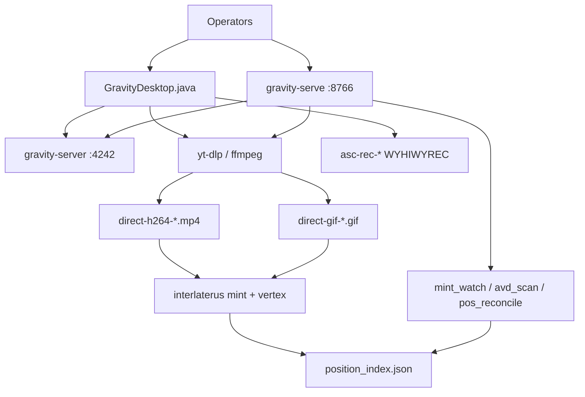
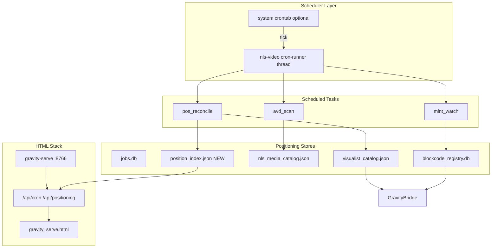
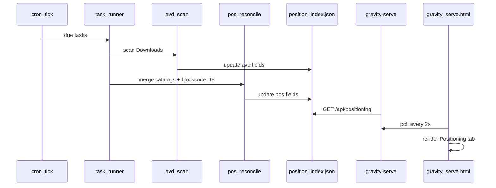
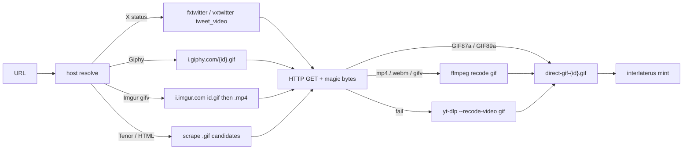
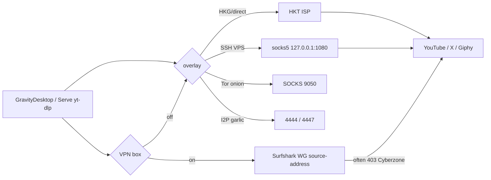
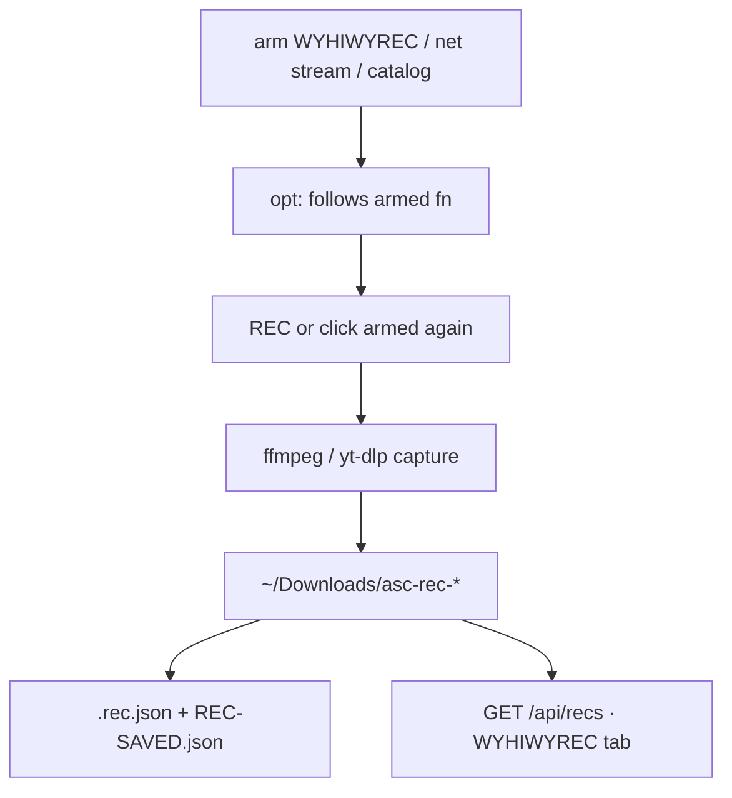

> Living approved plan for the **entire Gravity architecture**: desktop, serve, protocol, downloads (H.264 + GIF), VPN/overlays, recording (WYHIWYREC), AVD/POS cron, mint. Original July 2026 AVD/POS-only design: [`plan.original.md`](plan.original.md).

# Approved Plan — Gravity stack

**Upgraded 2026-09-02.** Serve: http://127.0.0.1:8766/plan

| Phase | Scope | Status |
|-------|--------|--------|
| 0 | Whole-stack architecture (protocol, clients, mint, community) | **Shipped** (documented here) |
| 1–3 | AVD/POS cron, position_index, Scheduled + Positioning tabs | **Shipped** |
| 4 | Character Designer — Form is Feed from Source(1)(2)(3)(4)+(N) | In progress |
| 5 | GIF Direct — Java GIF trigger + Serve `POST /api/download {gif:true}` | **Shipped 2026-09-02** |
| 6 | VPN / overlay path (HKG/direct, Surfshark opt-in, SSH SOCKS, Tor, I2P) | **Shipped** |
| 7 | Recording — WYHIWYREC / net stream / catalog → `asc-rec-*` + Serve Recs tab | **Shipped** |
| 8 | Gravity Switcher — **separate applet** · ON/OFF lock · NNLR · Security | **Shipped** |
| 9 | Vacuum / TLS-JA3 / generic-site downloads · detail log (Desktop + Serve) | **Shipped** |
| 10 | NLS Codec (nonlineari) — form-follows-function surround + gravity-serve embeds worker/server | **In progress** |
| 11 | Film language — FFT 6-track edit, IPA/YOLO search, Java+Qt EMP | **Shipped lean** (`film-language/`) |

---

# Entire architecture

Two clients, one protocol. Vertical mint stack + horizontal convert worker. Cron keeps AVD↔POS paired. Downloads, GIFs, and recs land in `~/Downloads/` and show on Serve.



| Port | Process | Meaning |
|------|---------|---------|
| `127.0.0.1:4242` | gravity-server | Live jobs + catalog pulse |
| `127.0.0.1:8766` | gravity-serve | HTML + REST + this plan |
| `127.0.0.1:1080` | SSH SOCKS optional | Preferred overlay vs Surfshark |
| `:9050` / `:4444` | Tor / I2P optional | Onion / eepsites — not YouTube |

Handshake: server `GRAVITY\x00\x01` → client 32×`0x42` → server 32×`0x00` → client 48×`0x43` → JSON `gravity_update` lines.

Run:

```bash
nls-video gravity-server --port 4242
~/Downloads/GravityDesktop/run-gravity-serve.sh
~/Downloads/GravityDesktop/run.sh
```

---

# Cron Jobs for AVD/POS Catalog Positioning (Gravity HTML Stack)

## What you confirmed

- **AVD** and **POS** are **catalog positioning concepts**, not Android emulators or retail Point-of-Sale systems.
- Target is the **current stack**: [`gravity_serve.html`](gravity_serve.html) + [`nls_video_pipe.py`](nls_video_pipe.py) + system cron — not a new Node/Workers app.

## Concept mapping (grounded in existing code)

| Term | Meaning in this stack | Existing data |
|------|----------------------|---------------|
| **AVD** (Analog Video Data) | ASC **filmic/analog side** — direct H.264 + GIF downloads, probe vectors, FILMIC playback path | `asc_mode` in [`_enrich_visualist_item`](nls_video_pipe.py), `~/Downloads/direct-h264-*`, `direct-gif-*`, interlaterus probe metadata |
| **POS** (Position) | **Placement** in catalog space — tesseract vertex + storage memory zone | `vertex` in [`interlaterus_desktop.py`](interlaterus_desktop.py) + `storage_memory_category` in [`get_storage_memory_category`](nls_video_pipe.py) |
| **Symmetric view** | ASC (AVD) vs SC (POS) already rendered in ASC Live tab | [`renderAsc`](gravity_serve.html) lines 551–560 |



## Architectural approach

### 1. Two-layer scheduling (not browser cron)

Browsers cannot run real cron. Scheduling lives **server-side**:

| Layer | Role | When to use |
|-------|------|-------------|
| **In-process runner** | Background thread inside `gravity-serve` (or standalone `nls-video cron-runner`) polls due tasks every 30–60s | Dev, always-on dashboard |
| **System crontab** | `*/5 * * * * nls-video cron tick` as a safety net / headless mode | Production, reboot survival |

Both call the same task registry — one code path, two triggers.

### 2. Task registry (new SQLite table, same DB as jobs)

Add `cron_tasks` table to existing [`jobs.db`](nls_video_pipe.py) (or sibling `cron.db` under `~/.local/share/nls-video/`):

```sql
cron_tasks (
  id, name, task_type,   -- mint_watch | pos_reconcile | avd_scan
  schedule_cron,         -- "*/10 * * * *" or interval_sec
  enabled, last_run, next_run, last_status, last_error, config_json
)
cron_runs (id, task_id, started, finished, status, result_json)  -- audit log
```

Default seed tasks on first run:

- **mint_watch** — every 10 min: scan `~/Downloads/direct-h264-*` and `direct-gif-*`, mint if missing (wraps [`interlaterus_desktop.py watch`](interlaterus_desktop.py) logic)
- **pos_reconcile** — every 30 min: merge vertex + `storage_memory_category` into unified position index
- **avd_scan** — every 15 min: tag analog files with AVD records (probe hash, asc_mode=FILMIC)

### 3. Position index (new canonical POS artifact)

New file: `~/.local/share/nls-video/position_index.json`

Each entry links catalogs:

```json
{
  "id": "sha256-or-pattern",
  "avd": { "path": "~/Downloads/direct-h264-….mp4 | direct-gif-….gif", "asc_mode": "FILMIC", "probe": {} },
  "pos": { "vertex": [0,1,0,1], "pattern_code": "AB.2:4.P&B.F1", "storage_memory_category": { "zone": "default-zone", ... } },
  "synced_at": "ISO8601"
}
```

**pos_reconcile** reads from three sources and writes one view:

- [`visualist_catalog.json`](nls_video_pipe.py) — worker outputs + `storage_memory_category`
- [`nls_media_catalog.json`](interlaterus_desktop.py) — interlaterus mints + `vertex`
- [`blockcode_registry.db`](interlaterus_desktop.py) — authoritative vertex occupancy

Conflict rule: **blockcode DB wins for vertex**; **visualist catalog wins for storage_memory_category**; AVD path from newest file mtime.

### 4. Task implementations (reuse, don't rewrite)

| Task | Reuses | Does |
|------|--------|------|
| `mint_watch` | `interlaterus_desktop.mint_media_file` | Idempotent mint for new downloads |
| `avd_scan` | `probe_media`, `_recent_downloads_list` | Build/update AVD side of position_index |
| `pos_reconcile` | `get_storage_memory_category`, `occupied_vertices` | Align POS fields; flag orphans (mint without catalog, catalog without vertex) |

No new mint/blockcode logic — only orchestration and indexing.

### 5. API surface (extend gravity-serve Handler)

New endpoints in [`cmd_gravity_serve`](nls_video_pipe.py):

| Method | Path | Purpose |
|--------|------|---------|
| GET | `/api/cron` | List tasks + last run status |
| GET | `/api/cron/runs` | Recent run log (tail 50) |
| POST | `/api/cron/run` | Manual trigger `{ "task_id": N }` |
| POST | `/api/cron/toggle` | Enable/disable task |
| GET | `/api/positioning` | Full or filtered position_index (AVD/POS pairs) |
| GET | `/api/positioning/orphans` | Items missing AVD or POS half |

Existing [`/api/gravity`](nls_video_pipe.py) enrichment extended to attach `position` summary per catalog item (vertex + zone) so ASC Live tab stays in sync without extra poll.

### 6. HTML stack changes ([`gravity_serve.html`](gravity_serve.html))

Add two tabs (same polling pattern as Jobs — 2s interval):

**Scheduled tab**
- Table: task name, cron expression, last run, status, next run
- Buttons: Run now, Enable/Disable
- Mirrors existing jobs table UX (cancel button pattern)

**Positioning tab**
- Split panel: **AVD (ASC filmic)** | **POS (vertex + zone)**
- Rows from `/api/positioning`
- Orphan badges (e.g. "POS missing", "AVD stale")
- Optional: simple vertex grid 4×4 heatmap (16 tesseract cells, occupied count)

ASC Live tab enhancement: include `vertex` and full `storage_memory_category` per catalog row (today only shows `zone`).

### 7. CLI + crontab wiring

New subcommands in [`nls_video_pipe.py`](nls_video_pipe.py):

```bash
nls-video cron list
nls-video cron tick          # run all due tasks once (for crontab)
nls-video cron run --id 2    # manual
nls-video cron-runner        # foreground daemon (alternative to in-process thread)
```

Example crontab entry (document in [`Installation.md`](Installation.md)):

```cron
*/10 * * * * /usr/bin/nls-video cron tick >> ~/.local/share/nls-video/cron.log 2>&1
```

[`run-gravity-serve.sh`](run-gravity-serve.sh) optionally starts in-process cron thread via `GRAVITY_CRON_ENABLED=1`.

## Data flow for a scheduled tick



## What we explicitly avoid

- Browser `setInterval` as the only scheduler (fine for UI refresh, not for mint/reconcile)
- Separate frontend framework or new database product
- Android adb or retail POS integrations
- Killing long-running worker jobs from cron (cron tasks are **read-mostly reconcile**, not pipeline replacement)

## File touch list

| File | Change |
|------|--------|
| [`nls_video_pipe.py`](nls_video_pipe.py) | `cron_tasks` schema, task runners, APIs, optional in-process scheduler |
| [`gravity_serve.html`](gravity_serve.html) | Scheduled + Positioning tabs, poll handlers |
| [`interlaterus_desktop.py`](interlaterus_desktop.py) | Extract mint-watch loop into callable `run_watch_once()` (no duplicate logic) |
| [`run-gravity-serve.sh`](run-gravity-serve.sh) | `GRAVITY_CRON_ENABLED` env |
| [`Installation.md`](Installation.md) | crontab example + AVD/POS glossary |
| [`ARCHITECTURE.md`](ARCHITECTURE.md) | scheduler diagram + position_index doc |

## Phased delivery

**Phase 1 — Foundation**
- SQLite cron registry + `cron tick` CLI
- `pos_reconcile` + `position_index.json`
- `/api/positioning` + Positioning tab

**Phase 2 — Automation**
- `mint_watch` + `avd_scan` tasks
- `/api/cron` + Scheduled tab + manual run
- In-process scheduler in gravity-serve

**Phase 3 — Ops**
- System crontab template, run logs, orphan alerts in UI
- ASC Live enrichment with vertex/zone

## Success criteria

- Cron tick updates `position_index.json` without manual steps
- gravity-serve Positioning tab shows matched AVD↔POS pairs
- Orphaned mints (vertex but no file, or file but no vertex) are visible
- `nls-video cron tick` is safe to run from crontab (idempotent, no duplicate mints)
- Existing worker / direct download / cancel flows remain unchanged

## Todos

- [x] **cron-schema** — Add cron_tasks + cron_runs SQLite schema and seed default tasks (mint_watch, pos_reconcile, avd_scan)
- [x] **position-index** — Implement position_index.json builder: pos_reconcile merges visualist + interlaterus + blockcode DB
- [x] **task-runners** — Extract interlaterus watch into run_watch_once(); implement avd_scan and cron tick runner
- [x] **api-endpoints** — Add /api/cron, /api/cron/run, /api/positioning to gravity-serve Handler
- [x] **html-tabs** — Add Scheduled + Positioning tabs to gravity_serve.html with 2s polling
- [x] **ops-wiring** — Document crontab in Installation.md; GRAVITY_CRON_ENABLED in run-gravity-serve.sh
- [x] **vertex-form-from-source** — Fix mint pile-up on `[0,0,0,0]`; content-addressed `vertex_from_digest`; `rebalance-vertices`
- [x] **character-form-modes** — Dual form: hand-drawn character **or** character captured in video (`character register`)
- [x] **gif-trigger-java** — GIF button next to H.264; X tweet_video via fxtwitter/vxtwitter
- [x] **gif-all-hosts** — Native HTTP GIF; Giphy / Tenor / Imgur; recode only for video sources
- [x] **gif-serve-api** — Serve `POST /api/download {gif:true}` matches GravityDesktop
- [x] **gif-catalog** — Recent Downloads host + X titles + `` play
- [x] **vpn-opt-in** — HKG default off; overlay HKG/direct · SSH · Tor · I2P; Surfshark checkbox
- [x] **rec-arm** — WYHIWYREC / net stream / catalog; Serve `/api/recs` tab
- [x] **gravity-switcher** — Separate applet ON/OFF; env lock; NNLR; Desktop SWITCHER
- [x] **generic-http** — non-YouTube `-f best` + scrape
- [x] **tls-ja3** — curl_cffi Chrome impersonate; opt-out on Desktop + Serve
- [x] **vacuum** — opt-in strip; detail + log; `GET /api/vacuum/log`
- [ ] **character-designer** — Character Designer — Form is Feed from Source(1)(2)(3)(4) [Viral RNA] (profiles, fold stage, UI)

---

## Phase 4 — The Character Designer

> **Form is Feed from Source(1)(2)(3)(4)** with a fifth source **and (N)** — Viral (RNA) multi-dose scope.

Hand-drawn system (notebook): form does not invent itself; it is **fed** by four source channels into the Character Designer, then scaled on a Fibonacci stage and placed on the tesseract (POS).

### Form matrix (confirmed)

Two **orthogonal** axes — acquisition × dimensional space:

| | **`2d_graphics`** | **`3d_form`** |
|--|-------------------|---------------|
| **`hand_drawn`** | sketch, poster, kaleidoscopic still (e.g. *Naked Nuras Loves Rave*) | authored mesh / sculpture model (`.obj` `.glb` …) |
| **`video_capture`** | character frame from video | volumetric/scan capture tagged 3D |

| Field | Values | Meaning |
|-------|--------|---------|
| `form_mode` | `hand_drawn` \| `video_capture` | How form was acquired |
| `form_space` | `2d_graphics` \| `3d_form` | 2D graphics **or** 3D form (sculpture lineage) |

**Historic lineage:** graphic characters can carry sculpture history  
(`--historic sculptures --lineage "sculpture → graphic"`).

**Theory lineage (designer-philosophers + games):** nested *Tractatus* structure  
(1…7 propositions) maps onto Sources (1)(2)(3)(4)+(N) — picture theory = form as logical picture of facts; game designers = ludic spatial identity.

Same pipeline after ingest: digest → `pattern_code` + `vertex` →  
`~/.local/share/interlaterus-desktop/character_catalog.json`.

```bash
# 2D graphic (poster / hand-drawn look) with sculpture historic
python3 interlaterus_desktop.py character register \
  --file ~/art/naked-nuras-loves-rave.jpg \
  --mode hand_drawn --space 2d_graphics \
  --name "Naked Nuras Loves Rave" \
  --historic sculptures --historic rave \
  --lineage "sculpture tradition → mirrored 2D graphic character" \
  --aesthetic "kaleidoscopic face · Naked Nuras Loves Rave"

# 3D form (mesh / sculpture)
python3 interlaterus_desktop.py character register \
  --file ~/models/hero.obj --mode hand_drawn --space 3d_form --name "Hero sculpt"

# Captured from video
python3 interlaterus_desktop.py character register \
  --file ~/Downloads/direct-h264-xxx.mp4 --mode video_capture --at 2.5

python3 interlaterus_desktop.py character list
```

### Source channels → stack mapping

| Source | Notebook label | Pipeline feed |
|--------|----------------|---------------|
| **(1)** | New [formation] of design particles / code | `pattern_from_digest` + `vertex_from_digest` (blockcode) |
| **(2)** | Visual lines from AI input / gravity | hand-drawn asset **or** video frame; ASC / visualist |
| **(3)** | Abstraction layer forming / signal | probe / sha256 / audio_vector when video |
| **(4)** | Quantum expanded realism / notes unique types | `--notes`, zones, unique types |
| **(N)** | Fifth source — Viral (RNA) multi-dose | mint_watch; multi-tenant vertex cells |

### Geometry (from diagrams)

- **Observer fan** — semi-circle of design particles; weighted sum \(I_p = \sum w_i x_i\) (image identifier processing on N/Z axes)
- **Fibonacci stage scale** — `angle = φ⁻¹` (`PHI_INV ≈ 0.618`), fold.x stages
- **Structure AB / AABB** — existing SPATIAL codes in pattern
- **A·V** — audio_vector coupled to vertex (AVD ↔ POS) when form is video-derived

### Vertex bug (fixed)

Old `pick_vertex`: after all 16 exclusive tesseract cells filled, fell through to  
`TESSERACT_VERTICES[len(occ) % 16]` → **always `[0,0,0,0]`** (235/250 mints).

New: **Form is Feed from Source** — `vertex = vertex_from_digest(sha256)` (4 independent bits).  
Repair: `python3 interlaterus_desktop.py rebalance-vertices --all` then `nls-video cron run --id 2`.

### Remaining Character Designer work

- [x] Dual acquisition: `hand_drawn` \| `video_capture`
- [x] Dual space: `2d_graphics` \| `3d_form` (+ mesh suffixes)
- [x] Historic tags / sculpture lineage + aesthetic reference (Nuras look)
- [x] Tractatus / designer-philosopher theory block on each character record
- [x] **Community principle** — document: all GravityDesktop communication = community (ARCHITECTURE.md)
- [ ] Wire Sources (2)(3)(4) weights into a single `character_profile` on gravity POS/ASC UI
- [ ] Fibonacci fold stage on ASC Live / POS heatmap (16-cell grid already in plan)
- [ ] Viral (RNA) multi-dose: mint_watch dose limits + re-mint policy already partly done (`max_mints`)
- [ ] Optional: observer-weighted image identifier API for semi-constructed frames
- [ ] Bridge **audio-ml-toolkit** community pipes (IM / voice / MIDI-NLS) into gravity-serve / NCOMM

---

## Phase 5 — GIF Direct (shipped 2026-09-02)

> **Approved.** Same trigger in GravityDesktop and Gravity Serve. Native GIFs over HTTP; X/Twitter `tweet_video` recode; Giphy / Tenor / Imgur resolvers; yt-dlp recode only as fallback. Do **not** pass `--merge-output-format gif` (yt-dlp rejects it and treats `.gif` URLs as webpages).

### Triggers

| Surface | Control | API / output |
|---------|---------|----------------|
| GravityDesktop | **GIF** button (magenta, under **H.264**). Enter/drag auto-GIFs `.gif`, Giphy, Tenor, X `tweet_video` | `~/Downloads/direct-gif-{id}.gif` |
| Gravity Serve | **GIF Direct** next to **H.264 Direct**. Enter auto-GIFs the same hosts | `POST /api/download` `{ "url", "gif": true, "mint": true }` |

### Download path (Java + `nls_video_pipe._save_as_gif`)



| Host | Detection | Direct media |
|------|-----------|--------------|
| X / Twitter `…/status/{id}` or `x.com/i/status/{id}` | `_X_STATUS_RE` | `video.twimg.com/tweet_video/*.mp4` → recode GIF |
| Giphy page or `media.giphy.com` | `_extract_giphy_id` | `https://i.giphy.com/{id}.gif` native |
| Tenor view / `media.tenor.com` | HTML scrape | native `.gif` |
| Imgur `.gif` / `.gifv` | `_extract_imgur_id` | `.gif` then `.mp4` recode |
| Direct `.gif` URL | magic `GIF8` | HTTP copy as-is |
| Other video (YouTube, …) | GIF trigger forced | yt-dlp `--recode-video gif` |

### Catalog (`GET /api/downloads`)

Recent Downloads cards: `kind=gif`, `host` (`x` / `giphy` / `tenor` / `imgur` / `youtube`), `media_id`, X status `source_url`, tweet title via fxtwitter when the filename id is a 15+ digit status. Play uses `` not `<video>`. Files served `image/gif` at `/downloads/direct-gif-*.gif`.

### Files

| File | Change |
|------|--------|
| [`GravityDesktop.java`](GravityDesktop.java) | GIF button, `saveAsGif`, X/Giphy/Tenor/Imgur resolvers, no `--merge-output-format gif` |
| [`nls_video_pipe.py`](nls_video_pipe.py) | `_save_as_gif`, `api_direct_download(gif=True)`, catalog `host` + X titles |
| [`gravity_serve.html`](gravity_serve.html) | GIF Direct, GIF player, download cards |

### GIF Direct todos

- [x] **gif-trigger-java** — GIF button next to H.264; X `tweet_video` via fxtwitter/vxtwitter
- [x] **gif-all-hosts** — Native HTTP GIF (magic bytes); Giphy / Tenor / Imgur; recode only when source is video
- [x] **gif-serve-api** — `POST /api/download {gif:true}` uses `_save_as_gif` (not invalid merge-output-format gif)
- [x] **gif-catalog** — `/api/downloads` host + X titles + `image/gif` play; mint_watch already matches `direct-gif-*.gif`

---

## Phase 6 — VPN / overlay path (shipped)

> **Approved.** Kernel VPN is **opt-in**. **Do not stack** Surfshark + Astrill. YouTube on Surfshark Cyberzone **403s**. Astrill Stealth = `tun0` `198.18.x`. Archive `~/Downloads/NLS-Astrill`. Prefer HKG/direct or SSH VPS SOCKS for YouTube.

### Route table

| Control | Path | Downloads |
|---------|------|-----------|
| Overlay **HKG/direct** (default), VPN unchecked | HKT ISP | YouTube / GIF / most URLs |
| Overlay **SSH VPS** + `run-ssh-socks.sh` | `socks5://127.0.0.1:1080` | Preferred when geo/403; not Surfshark |
| Overlay **Tor onion** | SOCKS `:9050` | Onion; YouTube often 403 on Tor exits |
| Overlay **I2P garlic** | HTTP/SOCKS `:4444`/`:4447` | Eepsites only — no YouTube outproxy |
| **VPN** + **Astrill** | `tun0` `198.18.x` (`/usr/local/Astrill/astrill`, `~/.config/astrill`) | China hotel DPI / StealthVPN. Do not stack Surfshark. |
| **VPN** + **Surfshark** | `surfshark_wg` `--force-ipv4 --source-address` | CMHK backup. Datacenter 403. Brave cookies + `tv,web`. Never android client. |

Java: `vpnCheck`, `overlayBox`, `useVpnRoute()`, `describeNetworkRoute()`, `run-ssh-socks.sh`. Leave VPN **unchecked** unless downloads must ride the tunnel.



### VPN todos

- [x] **vpn-opt-in** — HKG default off; checkbox + `GRAVITY_USE_VPN`
- [x] **overlay-paths** — HKG/direct · SSH VPS · Tor onion · I2P garlic
- [x] **ssh-socks** — `run-ssh-socks.sh` / `GRAVITY_SSH_HOST`; prefer over Surfshark for YouTube
- [x] **yt-403** — cooldown, cookies, `tv,web` player clients; no android PO-token client

---

## Phase 7 — Recording system (shipped)

> **Approved. Form follows function.** Arm a rec mode (filled = armed). Click armed again or **REC** to start. **opt:** shows only that mode’s modifiers. **STOP** / **SAVE** stay global.

### Arm → opt → trigger

| Armed | Function | opt: |
|-------|----------|------|
| **WYHIWYREC** | TASCAM / PipeWire monitor — what you hear | format, NTS 1/2 (hear URL), hear, auto, sig |
| **net stream** | Icecast / URL dump of the bar | format, NTS 1/2, copy |
| **catalog** | selected ASC row | format, copy |

**out:** Speaker / TASCAM / HDMI / gravity-out / PipeWireVirtual (`pw` → `pw-loopback -n gravity-pw`). **alsa** off = card profiles Off. SIGNAL meter only for WYHIWYREC.

Takes: `~/Downloads/asc-rec-*` (WAV 48k/24 default, FLAC, AAC, MP3; ffmpeg stillimage MP4 wraps). Index `REC-SAVED.json`. Sidecar `<file>.rec.json` (`fn`, `title`, `source_url`, `format`).

Serve: **WYHIWYREC** tab `http://127.0.0.1:8766/#recs`. `GET /api/recs`, `GET /api/downloads` → `{items, recs, counts}`. Play + Locate. Rec-video MP4 plays in the video player.



### Rec todos

- [x] **rec-arm** — WYHIWYREC / net stream / catalog arm; opt: follows function
- [x] **rec-out** — sink picker, route, alsa, pw loopback `gravity-pw`
- [x] **rec-files** — `asc-rec-*` + sidecar + `REC-SAVED.json`
- [x] **rec-serve** — `/api/recs`, WYHIWYREC tab, Play + Locate

---

## Phase 8 — Gravity Switcher (approved concept)

> **Yes, build it — as this stack, not a new product.** Path agent for `tor | internet | vpn | i2p` on **WAN and LAN**. Logs package switches. ML (Grok / M2L) reads those logs when you ask about NLS online systems. Notebooks: NLS observer circle · Automation.13 central processing · RAND multi-layer. Live plate: https://clover-juniper-iris-bird.grok.me/

**Do not duplicate** GravityDesktop overlay + VPN. The switcher **orchestrates** what already exists and writes an audit log the agent can read.

### Repo references (security · transport · mobility)

| Repo / tree | Role |
|-------------|------|
| [nonlineari/NCOMM](https://github.com/nonlineari/NCOMM) | Transport + mobility: USB-C / WiFi / dual WAN·LAN topologies, `diagnose-network.sh`, Tesseract 16-vertex net, LEN security, M2L ML |
| [nonlineari/security-monitoring](https://github.com/nonlineari/security-monitoring) | Packet / calibration / JIT ML encoder (private) |
| [nonlineari/cim](https://github.com/nonlineari/cim) `09_scis/` | Secure Noise transport (SCIS) |
| `~/Videos/nls-portal-os/nlsmobility` | Mobility layer (Momentum · nonlineari · simcolliges) |
| GravityDesktop overlay | Already: HKG/direct, SSH VPS, **Tor onion :9050** (system `tor`, not Brave), I2P garlic, VPN Astrill `tun0` / Surfshark WG |

### Notebook → stack (Grok mapping)

| Sketch | Meaning | Switcher |
|--------|---------|----------|
| **NLS circle** (N/S, eye, orbit) | Observer / operator | GravityDesktop + Serve as presentation |
| **Automation.13** CPU + D/G1 | Central processing sys | Switcher agent: choose path, do not stack VPN |
| Left: NFS/encryption, CC contents, mobile system, OS i/o | Deconstruction | Path classes: crypto overlay, catalog, mobile WAN, local LAN |
| Right: traceroute, mail/domain, firewall WiFi UIDC, PGP | Decentralization | `ip monitor` + NCOMM diagnose + LEN audit |
| **RAND layers** (presentation / application / data / security) | CIM `02_source_pdfs/RAND_System_Design_Document.pdf` | Serve UI · switcher API · switch log JSON · LEN/NCOMM |
| θ sum / i,j,Δt | Gravity θ + dual vi | Same θ already in the H.264 bar |

### Paths the agent may select (never stacked)

| Mode | Interface | When |
|------|-----------|------|
| **internet** | LAN `enp*` / WAN DHCP (HKG/direct) | Default YouTube / GIF |
| **vpn** | Astrill `tun0` 198.18.x **or** Surfshark WG — never both | China hotel DPI vs CMHK backup |
| **tor** | System `tor` SOCKS `127.0.0.1:9050` (already installed; **not** Brave onion) | `.onion` / OSINT |
| **i2p** | HTTP/SOCKS `:4444`/`:4447` | Eepsites only |

WAN vs LAN (from NCOMM `NETWORK-TOPOLOGIES.md`): USB-C bridge (LAN-only), WiFi same subnet, dual (bridge + default route), internet sharing. LAN is the default route interface. Optional `tun0` is the WAN overlay.

### Agent + logs

```
ip monitor link,addr,route  →  ~/.local/share/nls-video/switch-log.jsonl
  {ts, from, to, wan|lan, iface, src_ip, reason, pid}
GravityDesktop overlay/VPN  →  same log
Grok / M2L                  →  read log when asked “which path is NLS online on?”
```

APIs (proposed): `GET /api/switcher` status · `POST /api/switcher {path}` · `GET /api/switcher/log`. Serve tab **Switcher** next to Scheduled.

### Switcher todos

- [ ] **switch-log** — jsonl of iface/route/overlay/VPN changes (`ip monitor` + Java `describeNetworkRoute`)
- [ ] **switch-cli** — `nls-video switch tor|internet|vpn|i2p [--wan|--lan]` wrapping existing overlay/VPN
- [ ] **switch-agent** — never stack Astrill+Surfshark; 403 → uncheck VPN / SSH VPS; `.onion` → Tor :9050
- [ ] **switch-serve** — `/api/switcher` + dashboard tab
- [ ] **switch-ml** — optional M2L / Grok over switch-log (NCOMM protocols; clover-juniper plate)

---

## Community communication (GravityDesktop programming)

Every transport is a **community** surface:

| Pipe | Path / component | Shares |
|------|------------------|--------|
| Gravity live | `gravity-server` :4242 | jobs + catalog pulse |
| HTML community UI | `gravity-serve` :8766 | tabs, POS, cron, ASC |
| NCOMM | Interlaterus `export` | mint manifest peer-to-peer |
| audio-ML | `~/Downloads/audio-ml-toolkit` | voice clone + secure IM + MIDI/NLS |
| Character form | `character register` | 2D/3D identity in catalog |

See **ARCHITECTURE.md → Principle: all communication is community**.

---

## Phase 10 — NLS Codec (nonlineari) + pipeline form

> **Form follows function. Scale follows φ.** Worker convert was collapsing every soundtrack to stereo AAC 192k (`-ac 2`), which broke unlabeled 5.1/6ch (ffmpeg 6.1 exit 234) and discarded quad / 7.1 / 8-channel form. **NLS Codec** (short: **nonlineari**) keeps the source channel function.

### Naming

| Name | Role |
|------|------|
| **NLS Codec** | Full name (NLS Visualist audio) |
| **nls** | Short id (`technical.acodec`) |
| **nonlineari** | Short alias — same org as NCOMM / SCIS |

### Form follows function (channel layout)

The analog *form* is the source layout. The *function* is playback of that layout. Do **not** downmix surround to stereo.

| Source function | NLS Codec form | Bitrate (φ stages from 192k stereo) |
|-----------------|----------------|--------------------------------------|
| stereo (2) | `stereo` | 192k |
| quad (4) | `quad` | 256k |
| 5.0 (5) | `5.0` | 320k |
| 5.1 / unlabeled 6ch | `5.1` (all 6 kept) | 448k |
| 6.1 (7) | `6.1` | 512k |
| 7.1 / 8ch / 8.1-style | `7.1` (all 8 kept) | 640k |

ffmpeg native AAC has **no 8.1 layout**. 8 discrete channels encode as 7.1. Unlabeled 6/8ch get pan-identity onto `5.1` / `7.1` so the encoder accepts them without dropping channels.

Video scale already follows function: `fast-1080` only downscales; other presets keep source resolution (no fake 4K upsample).

### Pipeline process form

gravity-serve (GravityDesktop `run-gravity-serve.sh`) **embeds**:

1. HTTP dashboard `:8766`
2. Pipeline **worker** (convert queue)
3. TCP **gravity-server** `:4242` (Java handshake)

So Jobs live without a separate `nls-video gravity-server` process. Set `GRAVITY_SERVER_EMBEDDED=0` / `GRAVITY_WORKER_ENABLED=0` to split them.

### Files

| File | Change |
|------|--------|
| [`nls_video_pipe.py`](nls_video_pipe.py) | `nls_codec_plan`, surround-preserving convert, embed worker+server |
| [`GravityDesktop.java`](GravityDesktop.java) | Poll `/api/gravity` when TCP is offline |
| [`ARCHITECTURE.md`](ARCHITECTURE.md) | NLS Codec on presets |

### Todos

- [x] **nls-codec-layouts** — stereo, quad, 5.1/6ch, 7.1/8ch; no `-ac 2` surround collapse
- [x] **nls-codec-scale** — bitrate stages 192 / 256 / 448 / 640 (φ from stereo)
- [x] **serve-embed-worker-server** — gravity-serve starts worker + gravity-server
- [x] **desktop-serve-poll** — Java Jobs tab follows serve when `:4242` is down
- [x] **gravity-channel-split-mix** — GravityDesktop `gravity` checkbox + worker: split FL…LFE analog WAV 48k/24, mix back to NLS Codec layout (Queue no longer misuses `private` cookies as gravity)
